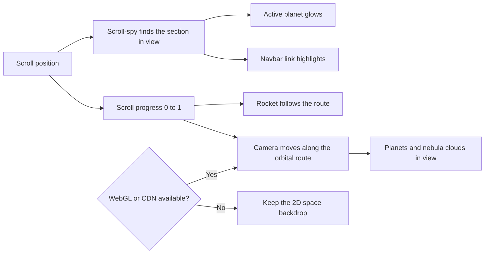

<div align="center">



<br />

[](https://reziichsan.github.io/Portfolio/)
[](#-contact)


**[🚀 Live Demo](https://reziichsan.github.io/Portfolio/)** &nbsp;·&nbsp;
**[📁 Projects](#-projects)** &nbsp;·&nbsp;
**[🧰 Tech Stack](#-tech-stack)** &nbsp;·&nbsp;
**[⚙️ Run Locally](#%EF%B8%8F-run-locally)** &nbsp;·&nbsp;
**[📬 Contact](#-contact)**

</div>

---

## 👋 Hi, I'm Rezi

I'm an **Informatics graduate from Telkom University** looking for an entry-level role in **web development, software engineering, or IT support**. This repository is the source code of my portfolio, a single-page site with a deep-space theme.

<table align="center">
  <tr>
    <td align="center"><b>🎯 Target role</b><br />Web Developer / IT</td>
    <td align="center"><b>🎓 Education</b><br />Informatics · GPA 3.01 / 4.00</td>
    <td align="center"><b>🗣️ English</b><br />EPrT 463 (B1 range)</td>
    <td align="center"><b>📍 Location</b><br />Bekasi, Indonesia</td>
  </tr>
</table>

<details>
<summary><b>📑 Table of contents</b></summary>

- [Features](#-features)
- [Projects](#-projects)
- [Tech stack](#-tech-stack)
- [How the page works](#%EF%B8%8F-how-the-page-works)
- [Run locally](#%EF%B8%8F-run-locally)
- [Deploy to GitHub Pages](#-deploy-to-github-pages)
- [Project structure](#%EF%B8%8F-project-structure)
- [Contact](#-contact)

</details>

---

## ✨ Features

| | Feature | Details |
| :-: | --- | --- |
| 🌌 | **Scroll-linked 3D scene** | A rocket flies along an orbital route while planets, drawn with custom GLSL shaders and no image textures, appear beside each section. Built with Three.js |
| ⭐ | **Space backdrop** | Canvas starfield with nebula clouds, parallax depth, and an occasional shooting star |
| 🧭 | **Scroll-spy navigation** | The navbar highlights the section in view, and that section's planet glows |
| 🎛️ | **Project filter** | Switch between *All*, *IT & Systems*, *UI/UX* and *AI / ML* instantly |
| 🕒 | **Live clock** | Current time in Jakarta (WIB), shown in the recruiter snapshot |
| 🖼️ | **Lightbox** | Certificates and design work open in a keyboard-accessible preview |
| ♿ | **Accessibility** | Skip link, focus styles, `prefers-reduced-motion` and `prefers-reduced-transparency` support |
| 🔎 | **SEO basics** | Meta tags, Open Graph and Twitter cards, canonical URL, and Person structured data |

> [!NOTE]
> The 3D scene is loaded from a CDN. If WebGL or the CDN is unavailable, the page keeps the regular 2D space background and everything else works normally.

---

## 📁 Projects

Open a project to see the details.

<details open>
<summary><b>🎫 AI-Assisted IT Helpdesk Ticketing Platform</b> &nbsp;·&nbsp; <code>Node.js</code> <code>Express</code> <code>SQLite</code> <code>Gemini API</code></summary>
<br />

A full-stack helpdesk app that analyses free-text issue reports with the Gemini API and suggests a priority level for each ticket.

- **Stack:** Node.js, Express, SQLite, Tailwind CSS, Gemini API
- **Result:** working local prototype
- **Repository:** [reziichsan/automated-it-ticketing-system](https://github.com/reziichsan/automated-it-ticketing-system)

</details>

<details>
<summary><b>📰 Multilingual Fake News Detection</b> &nbsp;·&nbsp; <code>Python</code> <code>NLP</code> <code>IndoBERT</code></summary>
<br />

My undergraduate thesis. It compares IndoBERT, multilingual BERT (mBERT) and XLM-R for hoax detection on a labelled dataset, with a pre-processing pipeline.

- **Result:** IndoBERT reached **88.62%** accuracy in the reported experiment
- **Repository:** [reziichsan/HoaxDetection](https://github.com/reziichsan/HoaxDetection)

</details>

<details>
<summary><b>🌲 Eternia Forest (Roblox)</b> &nbsp;·&nbsp; <code>Lua</code> <code>Game dev</code></summary>
<br />

A forest and mountain exploration map. I built gameplay scripts (checkpoints, summit tracking, leaderboards), prepared environment assets, and optimised the map to fix lag and crashes.

- **Result:** **355K+** visits and **1,000** peak concurrent players
- **Play:** [Eternia Forest on Roblox](https://www.roblox.com/id/games/115395112112752/Eternia-Forest)

</details>

<details>
<summary><b>🎨 UI/UX redesigns</b> &nbsp;·&nbsp; <code>Figma</code></summary>
<br />

- **JKT48 Website Redesign:** usability-driven homepage redesign, delivered as an interactive prototype with a design system. [View prototype](https://www.figma.com/proto/FRVgI1yITbqVChRG9dy10w/Redesign-HomePage-Website-JKT48?node-id=283-673&t=HHAQvjkovRpOFjPM-1)
- **EPerpusdikbud Mobile App Redesign:** alternative navigation and layout concepts for a digital library app. [View prototype](https://www.figma.com/proto/c0Gyv0ROHXc95EnG8ZDkIF/EPerpusdikbud-UI-Re-Design?node-id=1-4)

</details>

---

## 🧰 Tech stack

<div align="center">


</div>

| Area | Tools |
| --- | --- |
| **Site** | HTML5, CSS3 (custom properties, `color-mix`, `backdrop-filter`), vanilla JavaScript |
| **3D** | [Three.js](https://threejs.org/) with custom GLSL shaders |
| **Fonts and icons** | Bricolage Grotesque, Hanken Grotesk, Remix Icon |
| **Hosting** | GitHub Pages |

---

## 🛰️ How the page works



---

## ⚙️ Run locally

No build step is needed.

<details>
<summary><b>Show the commands</b></summary>
<br />

```bash
git clone https://github.com/reziichsan/Portfolio.git
cd Portfolio

# serve the folder, then open http://localhost:8000
python3 -m http.server 8000
```

Fonts, icons and Three.js load from CDNs, so an internet connection is needed for the full experience.

</details>

## 🚢 Deploy to GitHub Pages

<details>
<summary><b>Show the steps</b></summary>
<br />

1. Put `index.html`, `CV.pdf`, `robots.txt`, `sitemap.xml` and the `assets/` folder in the repository root.
2. Open **Settings → Pages**, choose the `main` branch and the `/ (root)` folder.
3. File names are **case-sensitive** on GitHub Pages, so the names in `assets/` must match `index.html` exactly.
4. Wait a minute or two for the build, then hard-refresh with `Ctrl + Shift + R`.

</details>

## 🗂️ Project structure

```text
.
├── index.html          # the whole site: HTML, CSS and JavaScript
├── CV.pdf              # linked from the "Download CV" button
├── robots.txt
├── sitemap.xml
├── README.md
└── assets/             # photos, certificates, design work and the README banner
```

---

## 📬 Contact

<div align="center">

[](mailto:reziichsan@gmail.com)
[](https://www.linkedin.com/in/reziichsannurarsyi/)
[](https://github.com/reziichsan)

<br />

If you have an opening, or just want to talk about a project, send me an email.

<sub>© Rezi Ichsan Nur Arsyi</sub>

</div>
